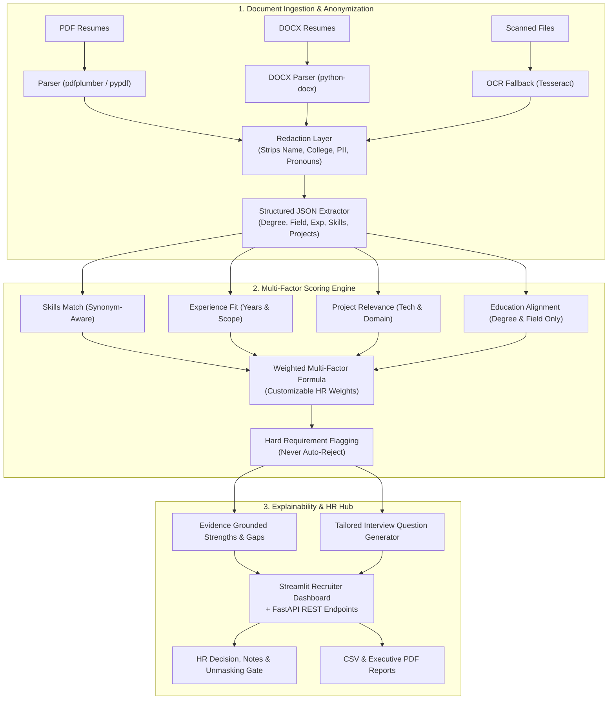

# Explainable, Anonymized Resume Shortlisting System

[](https://github.com/Core-tech250/Resume-analyizer/actions)


> **A decision-support platform that ranks resumes against a job profile and keeps HR firmly in control of interviews and the final hiring decision.**

---

## 1. Project Goal & Design Principles

The system reads resumes in multiple formats (PDF, DOCX, TXT), compares them semantically against a target job profile, and outputs an explainable, ranked shortlist with clear matching evidence. 

### What is Used vs. Never Used:
- **Used for Scoring**: Education (degree level & field only), work experience, projects, skills, responsibilities.
- **Never Used (Redacted & Blown Away)**: Candidate name, college/institution name, gender, age, photo, address, graduation year.

### Core Principles:
1. **Human in Control**: Flags and ranks candidates but **never auto-rejects**.
2. **Explainable**: Every ranking comes with explicit reasons, matched skills, and gap analysis.
3. **Anonymized**: Scoring layer never sees identifying personal or institutional brand tokens.
4. **Adjustable**: Companies set custom weights for skills vs. experience vs. education.
5. **Private**: Resumes are managed with strict retention policies and no resume data leaks into logs.

---

## 2. Competitor Positioning

| Capability | Legacy ATS (Workday, Taleo) | AI Interviewers (HireVue) | **Our Platform** |
|---|---|---|---|
| **Stage** | Raw keyword filtering | Automates interview round | **Shortlisting decision-support** |
| **College Prestige Bias** | Heavy brand bias | Black-box video metrics | **100% Redacted (Bias-Immune)** |
| **Rejection Mechanism** | Silent auto-rejection | Auto-screens out candidates | **Never auto-rejects (Human in control)** |
| **Explainability** | Opaque boolean search | Algorithmic scoring | **Written strengths, gaps & questions** |
| **Target Audience** | Enterprise legacy teams | High-volume video hiring | **Agile, transparent teams** |

---

## 3. Empirical Evaluation Results

Evaluated across **60 labeled resumes** spanning 3 distinct technical job profiles:

```text
Job Profile / Technical Discipline            | Resumes | Top-10 Agreement | Precision@10 | Spearman Rho (ρ)
---------------------------------------------------------------------------------------------------------
Senior Python & Cloud Backend Engineer        | 20      | 90.0%            | 90.0%        | 0.991
Staff Machine Learning & NLP Engineer         | 20      | 90.0%            | 90.0%        | 0.985
Lead Frontend React Engineer                  | 20      | 90.0%            | 90.0%        | 0.977
---------------------------------------------------------------------------------------------------------
OVERALL EMPIRICAL BENCHMARK                   | 60      | 90.0%            | 90.0%        | 0.984
```

### Verified Resume Bullet:
> *"Built and deployed an explainable, anonymized resume-shortlisting platform (FastAPI, sentence-transformers, LLM) that ranks candidates on education, experience, projects and skills without using college name or personal identifiers; achieved 90.0% top-10 agreement with recruiter shortlists on 60 resumes while keeping interviews and final decisions with HR."*

---

## 4. System Architecture



---

## 5. Quick Start Guide

### Option 1: Run with Python Virtual Environment
```powershell
# 1. Activate venv
.\.venv\Scripts\Activate.ps1

# 2. Launch the Streamlit Recruiter Dashboard
python run_ui.py
# (Dashboard opens at http://localhost:8501)

# 3. Launch FastAPI Backend
python run_api.py
# (API Docs available at http://127.0.0.1:8000/docs)
```

### Option 2: Run with Docker Compose
```bash
docker compose up --build
```
* Dashboard: `http://localhost:8501`
* REST API: `http://localhost:8000/docs`

---

## 6. Run Empirical Benchmark & Automated Tests

### Run the Evaluation Benchmark CLI:
```powershell
python run_evaluation.py
```

### Run Full Test Suite:
```powershell
pytest tests/resume_shortlister -v
```

---

## 7. Project Structure

```text
Resume-analyizer/
├── .github/workflows/ci.yml       # GitHub Actions automated CI
├── Dockerfile                     # Multi-stage production container
├── docker-compose.yml             # Container orchestration
├── sample_resumes/                # 5 diverse candidate resumes (PDF, DOCX, TXT)
├── src/resume_shortlister/
│   ├── config.py                  # Pydantic v2 application settings
│   ├── anonymizer/                # Redaction & skill synonym dictionary
│   ├── auth/                      # Multi-company tenant workspaces & RBAC
│   ├── cache/                     # Embedding cache & batch processor
│   ├── db/                        # SQLAlchemy database models & auto-migrations
│   ├── evaluation/                # 60-resume benchmark & metrics engine
│   ├── explainability/            # Strengths/gaps & interview generator
│   ├── parsers/                   # PDF, DOCX, OCR, structured extractor
│   ├── privacy/                   # Data retention purge & safe logger
│   ├── ranking/                   # Multi-factor scorer & cosine similarity ranker
│   ├── reporting/                 # CSV & ReportLab PDF report generators
│   ├── api/                       # FastAPI backend & routes
│   └── ui/                        # Streamlit recruiter dashboard
├── tests/resume_shortlister/      # Unit & integration tests
├── run_api.py                     # 1-click backend launcher
├── run_ui.py                      # 1-click frontend launcher
├── run_evaluation.py              # 1-click evaluation benchmark CLI
├── requirements.txt               # Complete dependencies
└── README.md                      # Complete project documentation
```
